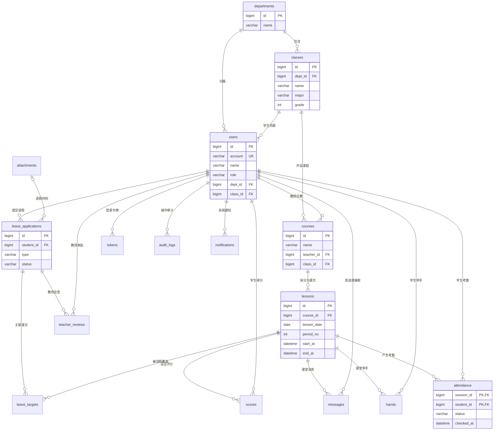

# 知序课堂数据库关系图

> 在 VS Code 中打开本文件后，按 `Ctrl + Shift + V` 即可预览关系图。
> 这份图由项目实际的 `V1__school.sql` 外键关系整理而来，可替代扩展收费版 ER 图用于答辩展示。

## 答辩说明

- `lessons` 是考勤的核心：一门 `courses` 课程会拆成多个具体课次。
- `attendance` 使用 `(session_id, student_id)` 联合主键，保证一个学生每节课只有一条考勤。
- `leave_targets` 将一张请假申请关联到多个具体课次；审批完成后，对应 `attendance` 状态更新为 `LEAVE`。
- `audit_logs` 记录教师更正考勤、审批请假等操作，保证修改可追溯。
